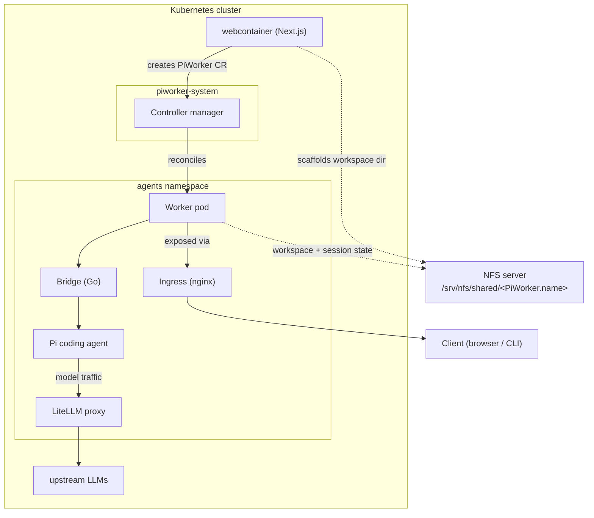

# piworker

The **PiWorker** operator runs the [Pi coding agent](https://pi.dev) in headless RPC mode and
exposes it behind an authenticated WebSocket endpoint reachable from outside the cluster.

## Architecture




## Built with

- **Go 1.26** — the controller manager and the bridge binary
  ([controller-runtime](https://pkg.go.dev/sigs.k8s.io/controller-runtime) +
  [Kubebuilder](https://book.kubebuilder.io/) scaffolding).
- **Kubebuilder** — CRD generation, controller scaffolding, RBAC markers, envtest.
- **Kustomize** — deployment manifests (`config/`), per-environment patches.
- **Docker / BuildKit** — two images: a distroless controller (`Dockerfile`) and a
  Node-based worker (`Dockerfile.worker`).
- **Node.js 22 + `@earendil-works/pi-coding-agent`** — the real Pi coding agent baked
  into the worker image, plus a baked-in LiteLLM provider extension.
- **LiteLLM** — OpenAI-compatible proxy the agent routes model traffic through.
- **Nginx Ingress** — per-instance public WebSocket endpoints with a wildcard TLS cert.
- **NFS (v3)** — operator-managed per-workspace mount (`<share>/<PiWorker.name>`) so the
  agent workspace and session state persist alongside the webcontainer frontend.
- **envtest** — in-cluster controller behavior tests (`make test`).

## Description

Each `PiWorker` custom resource makes the operator reconcile a hardened, single-replica
workload that runs:

1. the real `pi --mode rpc` coding agent (JSONL over stdin/stdout), and
2. a small Go **bridge** (`cmd/bridge`) that maps that JSONL protocol to an authenticated
   WebSocket endpoint at `/v1/rpc`.

The agent routes model traffic through a **LiteLLM** OpenAI-compatible proxy. The bridge
exposes the agent over HTTP so it can be reached through a per-instance Kubernetes
`Ingress`. The operator generates a unique random hostname per `PiWorker`
(`pw-<random>.<ingress-domain>`) and stores it in `.status.host`/`.status.endpoint`.

Pi's RPC protocol is bidirectional JSONL, not JSON-RPC; the bridge is a transparent transport
and does not reinterpret Pi commands or events. One WebSocket text frame is one Pi command
JSON object; one Pi stdout JSONL record becomes one outbound text frame. See the
[Pi RPC mode docs](https://pi.dev/docs/latest/rpc).

### Why two images

- `Dockerfile` builds the **controller manager** (distroless, reconciles resources).
- `Dockerfile.worker` builds the **worker image** (the bridge binary + the pinned
  `@earendil-works/pi-coding-agent` + Node + tools + a baked-in LiteLLM provider
  extension). The controller deploys this image for every `PiWorker`; it is
  operator-controlled, not user-selectable per CR.

### Prerequisites

- Go 1.26+
- Docker (or Podman)
- A Kubernetes cluster with an **Ingress controller** installed.
- A **wildcard DNS** record (e.g. `*.agents.example.com`) routing to the ingress
  controller, and a **TLS certificate/Secret** covering that wildcard.
- A reachable **LiteLLM** proxy exposing the OpenAI-compatible `/v1` API.
- Nginx Ingress is enabled.
### Configuration

The manager requires two flags (set as env in `config/manager/manager.yaml`):

- `--worker-image` — the worker image built from `Dockerfile.worker`.
- `--ingress-domain` — the wildcard base domain used to generate per-`PiWorker` hosts.
- `--worker-image-pull-secret` (optional) — name of a same-namespace
  `kubernetes.io/dockerconfigjson` Secret the worker Pod uses to pull the worker image.
- `--ingress-tls-secret` (optional) — default TLS Secret when a CR omits
  `spec.ingress.tlsSecretName`.
- `--nfs-server` / `--nfs-share` (optional) — when both are set, each worker Pod mounts
  `<nfs-share>/<PiWorker.name>` at `/workspace` over NFS (v3) instead of an ephemeral
  emptyDir. This aligns the agent workspace with the directory an upstream frontend
  (e.g. webcontainer) scaffolds under the same share. The agent session state is kept
  at `/workspace/.pi/agent` so it persists with the workspace across pod restarts.


### Building the two images

```sh
# Controller manager image (Dockerfile)
make docker-build docker-push IMG=<registry>/piworker-controller:<tag>

# Worker image (Dockerfile.worker) — bridge + Pi runtime. docker-build-worker depends on
# build-bridge, so the linux bridge binary (bin/bridge) is built first automatically.
make docker-build-worker docker-push-worker WORKER_IMG=<registry>/piworker-worker:<tag>
```

On an arm64 host building for an amd64 cluster, set `PLATFORM=linux/amd64` for both image
builds and also set `BRIDGE_GOARCH=amd64` for the worker build.

### Verifying the worker runtime

The worker pins Pi and its LiteLLM extension dependencies to **1.4.0**, on Node.js 22
(Pi requires >=22.19.0). It includes `bash`, `git`, `ripgrep`, `fd-find` (Debian's
`fdfind`, recognized by Pi), and CA certificates so search tools need no runtime download.
Project-specific tools such as Python, compilers, or browsers are not required for RPC startup.

Build and test the real Pi subprocess without network access or real model credentials:

```sh
make docker-build-worker WORKER_IMG=piworker-worker:pi-1.4.0-rpc-test

docker run --rm --network=none --read-only --cap-drop=ALL \
  --security-opt=no-new-privileges \
  --tmpfs /tmp:rw,nosuid,nodev,mode=1777 \
  --tmpfs /home/pi:rw,nosuid,nodev,uid=10001,gid=10001 \
  --tmpfs /workspace:rw,nosuid,nodev,uid=10001,gid=10001 \
  --mount "type=bind,src=$PWD/hack/test-worker-rpc.mjs,dst=/rpc-smoke.mjs,readonly" \
  --entrypoint node piworker-worker:pi-1.4.0-rpc-test /rpc-smoke.mjs
```

The smoke test runs as the image's non-root user, loads the baked-in LiteLLM extension,
checks model discovery and RPC with and without explicit provider/model flags, and executes
the preinstalled tools through RPC `bash`. A loopback-only mock verifies that Pi sends the
configured model and file-backed API key and consumes a streamed response. No real LiteLLM
service, paid model, or Kubernetes ingress is exercised.

### Running Pi directly inside a worker Pod

The controller sets `PI_CODING_AGENT_DIR`, `PI_LITELLM_BASE_URL`, `PI_LITELLM_MODEL`, and
`PI_LITELLM_API_KEY_FILE` on the worker container so `kubectl exec` shells and the bridge's
RPC subprocess share the same configuration. API keys remain in mounted Secret files;
`/login` is not needed for this LiteLLM provider.

For an existing Pod created by an older controller, configure the current shell manually
(replace the two placeholders with the PiWorker spec values):

```sh
export PI_CODING_AGENT_DIR=/workspace/.pi/agent
export PI_LITELLM_BASE_URL='<spec.litellm.baseURL>'
export PI_LITELLM_MODEL='<spec.model>'
export PI_LITELLM_API_KEY_FILE=/secrets/litellm/api-key
pi --provider litellm --model "$PI_LITELLM_MODEL"
```

The permanent fix requires deploying the updated **controller**, which reconciles the new
container environment and rolls the worker Pod. Rebuilding only the worker image does not
change an existing Pod's environment. If a PiWorker explicitly sets `spec.workerImage`,
update that field when releasing a new worker image; it overrides the manager default.

### Creating a PiWorker

The LiteLLM API key is provided **inline** in the spec; the controller copies it into a
controller-owned Secret (deleted with the `PiWorker`) and projects that Secret into the worker
Pod as a file — no `kubectl create secret` for it is needed. The client bearer token is
**auto-generated** by the controller into an owned Secret and exposed in
`.status.bearerTokenSecretRef`.

If the worker image lives in a private registry, create a pull Secret of type
`kubernetes.io/dockerconfigjson` in the namespace where the `PiWorker` will live:

```sh
kubectl apply -f https://raw.githubusercontent.com/kubernetes/ingress-nginx/controller-v1.15.1/deploy/static/provider/cloud/deploy.yaml

kubectl create namespace agents

kubectl create secret docker-registry pull-secret -n agents \
  --docker-server=ghcr.io \
  --docker-username=<user> \
  --docker-password=$GITHUB_TOKEN
```

Apply a `PiWorker`:

```yaml
apiVersion: ubi.pi.dev/v1alpha1
kind: PiWorker
metadata:
  name: my-agent
  namespace: agents
spec:
  model: glm-5.3-flash
  litellm:
    baseURL: http://litellm-proxy.default.svc:4000/v1
    apiKey: sk-litellm-REPLACE-ME      # inline; projected into the Pod via an owned Secret
  auth:
    allowedOrigins: ["https://console.example.com"]
  ingress:
    className: nginx
#    tlsSecretName: wildcard-agents-tls
```

The worker image and pull Secret default to the manager flags above; override them per CR with
`spec.workerImage` / `spec.workerImagePullSecret`.

Read the generated endpoint and the auto-generated bearer token:

```sh
kubectl get piworker my-agent -n agents -o jsonpath='{.status.endpoint}'
# wss://pw-<token>.agents.example.com/v1/rpc

TOKEN=$(kubectl get secret -n agents \
  $(kubectl get piworker my-agent -n agents -o jsonpath='{.status.bearerTokenSecretRef.name}') \
  -o jsonpath='{.data.token}' | base64 -d)
```

Connect with a WebSocket client that sends `Authorization: Bearer <token>`; each direction is
native Pi JSONL (one command/event per message). For example, send
`{"id":"req-1","type":"get_state"}` and read the JSONL response.

### Security boundary

A `PiWorker` runs an agent that executes **arbitrary code in its own workspace**. Treat each
instance as a remote-code-execution sandbox:

- The workload runs non-root, read-only root fs, dropped capabilities, RuntimeDefault seccomp,
  and no Kubernetes service-account token.
- The bridge requires a constant-time bearer token before upgrade and enforces browser
  Origin allow-listing; CLI clients without an Origin are allowed.
- One active session per pod (a Pi session is stateful and owns one subprocess).
- Project ingress-controller idle/timeout and HTTP-to-HTTPS redirect are installation-level
  concerns; configure them on the controller, not per CR.
- Restrict worker egress to DNS and the LiteLLM endpoint via a NetworkPolicy in production.

### Workspace persistence

The agent workspace is one of three, chosen in this order:

1. **NFS** (operator-wide, recommended with an upstream frontend) — when the manager runs
   with `--nfs-server`/`--nfs-share`, every worker Pod mounts
   `<nfs-share>/<PiWorker.name>` at `/workspace` over NFS. The directory must already exist
   under the share (typically scaffolded by a frontend like webcontainer). Pi session state
   is written to `/workspace/.pi/agent` so it persists with the workspace. The Deployment
   uses a `Recreate` rollout strategy so two pods never write the same NFS directory at once.
2. **PVC** — set `spec.workspace.persistentVolumeClaimName` to an existing same-namespace
   PVC for durable work without operator-level NFS (also `Recreate` rollout).
3. **emptyDir** (default) — ephemeral, erased on pod recreation (`RollingUpdate` rollout).


## Getting Started

### Prerequisites
- go version v1.24.6+
- docker version 17.03+.
- kubectl version v1.11.3+.
- Access to a Kubernetes v1.11.3+ cluster.

### To Deploy on the cluster
**Build and push your image to the location specified by `IMG`:**

```sh
make docker-build docker-push IMG=<some-registry>/piworker:tag
```

**NOTE:** This image ought to be published in the personal registry you specified.
And it is required to have access to pull the image from the working environment.
Make sure you have the proper permission to the registry if the above commands don’t work.

**Install the CRDs into the cluster:**

```sh
make install
```

**Deploy the Manager to the cluster with the image specified by `IMG`:**

```sh
make deploy IMG=<some-registry>/piworker:tag
```

> **NOTE**: If you encounter RBAC errors, you may need to grant yourself cluster-admin
privileges or be logged in as admin.

**Create instances of your solution**
You can apply the samples (examples) from the config/sample:

```sh
kubectl apply -k config/samples/
```

>**NOTE**: Ensure that the samples has default values to test it out.

### To Uninstall
**Delete the instances (CRs) from the cluster:**

```sh
kubectl delete -k config/samples/
```

**Delete the APIs(CRDs) from the cluster:**

```sh
make uninstall
```

**UnDeploy the controller from the cluster:**

```sh
make undeploy
```

## Project Distribution

Following the options to release and provide this solution to the users.

### By providing a bundle with all YAML files

1. Build the installer for the image built and published in the registry:

```sh
make build-installer IMG=<some-registry>/piworker:tag
```

**NOTE:** The makefile target mentioned above generates an 'install.yaml'
file in the dist directory. This file contains all the resources built
with Kustomize, which are necessary to install this project without its
dependencies.

2. Using the installer

Users can just run 'kubectl apply -f <URL for YAML BUNDLE>' to install
the project, i.e.:

```sh
kubectl apply -f https://raw.githubusercontent.com/<org>/piworker/<tag or branch>/dist/install.yaml
```

### By providing a Helm Chart

1. Build the chart using the optional helm plugin

```sh
kubebuilder edit --plugins=helm/v2-alpha
```

2. See that a chart was generated under 'dist/chart', and users
can obtain this solution from there.

**NOTE:** If you change the project, you need to update the Helm Chart
using the same command above to sync the latest changes. Furthermore,
if you create webhooks, you need to use the above command with
the '--force' flag and manually ensure that any custom configuration
previously added to 'dist/chart/values.yaml' or 'dist/chart/manager/manager.yaml'
is manually re-applied afterwards.

## Contributing
// TODO(user): Add detailed information on how you would like others to contribute to this project

**NOTE:** Run `make help` for more information on all potential `make` targets

More information can be found via the [Kubebuilder Documentation](https://book.kubebuilder.io/introduction.html)

## License

Copyright 2026.

Licensed under the Apache License, Version 2.0 (the "License");
you may not use this file except in compliance with the License.
You may obtain a copy of the License at

    http://www.apache.org/licenses/LICENSE-2.0

Unless required by applicable law or agreed to in writing, software
distributed under the License is distributed on an "AS IS" BASIS,
WITHOUT WARRANTIES OR CONDITIONS OF ANY KIND, either express or implied.
See the License for the specific language governing permissions and
limitations under the License.

